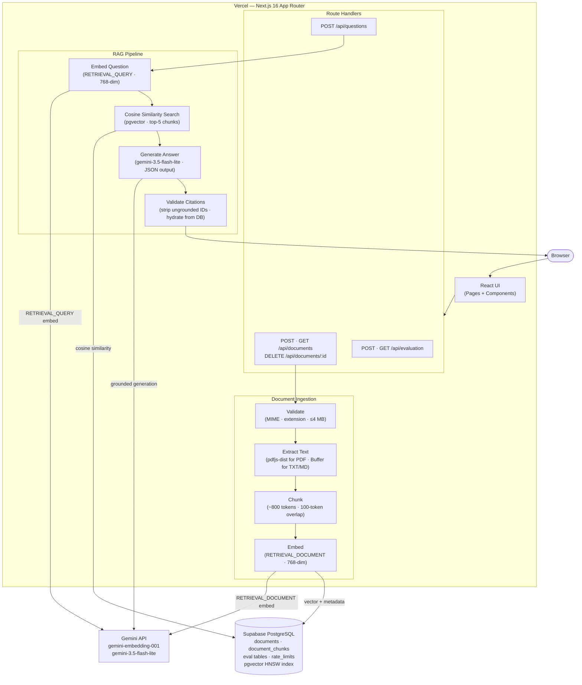
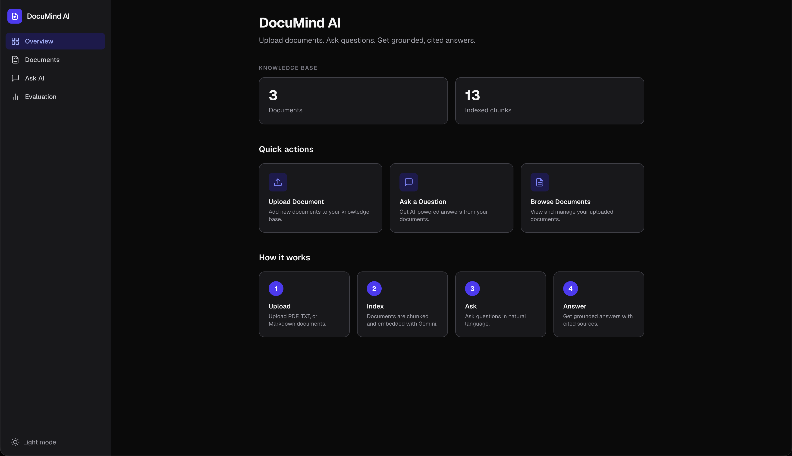
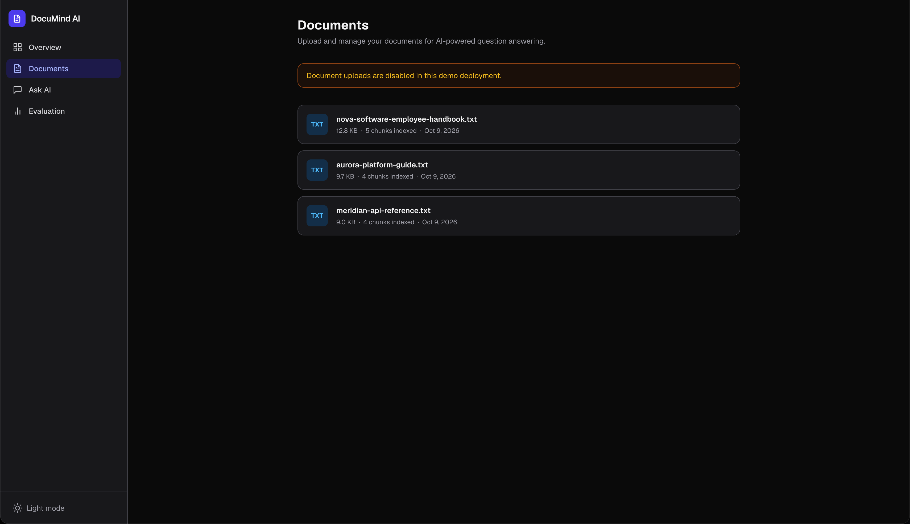
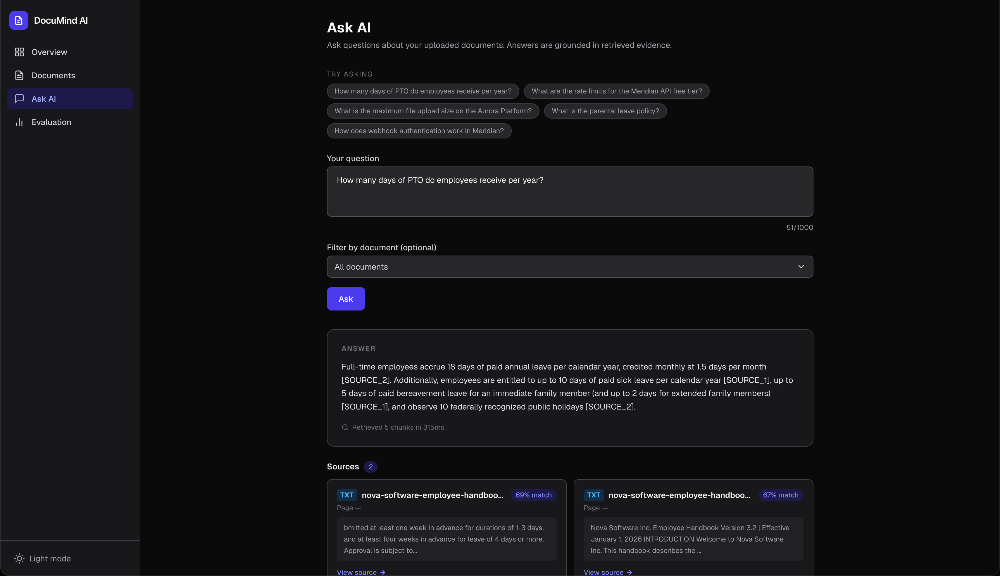
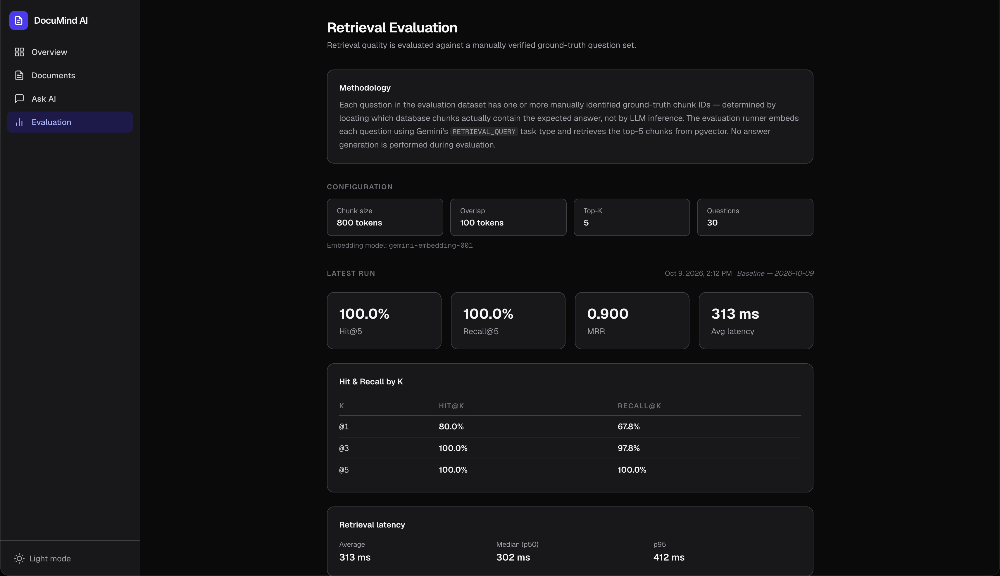

# DocuMind AI

DocuMind AI is a full-stack Retrieval-Augmented Generation (RAG) platform that transforms documents into a searchable knowledge base and generates source-grounded answers with validated citations.

Supports **PDF**, **TXT**, and **Markdown**. Built with Next.js 16, TypeScript, Gemini, PostgreSQL, and pgvector.

**Live Demo:** https://documind-ai-three-rho.vercel.app/

[](https://www.typescriptlang.org/)
[](https://nextjs.org/)
[](./src)
[](https://documind-ai-three-rho.vercel.app/)

**Docs:** [Architecture](docs/architecture.md) · [RAG Pipeline](docs/rag-pipeline.md) · [Evaluation](docs/evaluation.md) · [Deployment](docs/deployment.md)

---

## Overview

DocuMind AI ingests documents, chunks and embeds them with Gemini, stores vectors in PostgreSQL using pgvector, and answers questions by retrieving the most relevant passages and generating a response grounded exclusively in those passages.

All citations are **server-validated** before being returned — the model cannot invent filenames, page numbers, or source IDs. If the retrieved passages do not contain sufficient information, the application returns a `cannotAnswer` flag rather than a fabricated response.

Beyond basic Q&A, the project includes:

- A **retrieval evaluation framework** with Hit@K, Recall@K, and MRR metrics across a 30-question synthetic benchmark
- A **live evaluation dashboard** displaying per-run results
- **Persistent PostgreSQL-backed rate limiting** with HMAC-SHA-256 pseudonymous client keys and fail-closed design

---

## Demo

The live demo is preloaded with three sample documents (uploads and deletions are disabled via `ENABLE_UPLOAD=false`, `ENABLE_DELETE=false`):

| Document | Content |
|---|---|
| `nova-software-employee-handbook.txt` | HR policies — PTO, remote work, benefits, performance reviews |
| `meridian-api-reference.txt` | REST API reference — authentication, rate limits, webhooks, pagination |
| `aurora-platform-guide.txt` | SaaS platform guide — pricing tiers, SSO, data retention, support SLAs |

**Try these questions:**
- "How many days of PTO do employees receive per year?"
- "What are the rate limits for the Meridian API free tier?"
- "What is the maximum file upload size on the Aurora Platform?"
- "How does webhook authentication work in Meridian?"
- "What is the parental leave policy?"

---

## Key Features

### Document Ingestion
- Multi-format support: **PDF** (page metadata preserved via pdfjs-dist), **TXT**, **Markdown**
- Custom sliding-window chunker: ~800 tokens per chunk, 100-token overlap, minimum chunk size enforced
- 768-dimensional Gemini embeddings with `taskType: RETRIEVAL_DOCUMENT`
- pgvector HNSW index (`vector_cosine_ops`) for approximate nearest-neighbour search
- Atomic per-document ingestion — partial failures roll back via cascade delete

### Question Answering
- Query embedded with `taskType: RETRIEVAL_QUERY` (distinct from document embeddings)
- Top-5 chunk retrieval via pgvector cosine similarity
- `gemini-3.5-flash-lite` called with `responseMimeType: 'application/json'` and temperature 0.1
- Every `SOURCE_N` identifier in the model response is validated server-side against the retrieved chunk IDs — unrecognized IDs are discarded
- Citation metadata (filename, page number, passage) is populated from the database record, never from model output
- Returns `cannotAnswer: true` when the model signals insufficient context, rather than generating an unsupported answer

### Retrieval Evaluation
- 30-question synthetic benchmark with ground-truth chunk IDs established via deterministic substring matching (no LLM)
- Hit@1/3/5, Recall@1/3/5, MRR, average/median/p95 latency
- Results stored in PostgreSQL and displayed in the `/evaluation` dashboard

### Security
- HMAC-SHA-256 pseudonymous rate-limit keys (raw IPs are never stored)
- Persistent PostgreSQL-backed rate limiting: 5 req/min per client key on `/api/questions`
- Fail-closed rate limiter: DB failure → 503, not pass-through
- Prompt injection defense-in-depth with explicit untrusted-content delimiters
- Server-side citation validation prevents fabricated metadata
- RLS-protected `rate_limits` table; `service_role` only
- `ENABLE_UPLOAD` / `ENABLE_DELETE` feature flags enforced at the server level

---

## Architecture



---

## RAG Pipeline

### Document Ingestion

1. **Validate** — MIME type and file extension are both checked; max 4 MB (Vercel serverless body limit).
2. **Extract text** — PDFs parsed with `pdfjs-dist`, preserving per-page text and page numbers. TXT and Markdown read directly from buffer.
3. **Normalize** — Whitespace normalization, null-byte and control-character removal.
4. **Chunk** — Sliding-window algorithm: ~800 tokens per chunk (1 token ≈ 4 characters), 100-token overlap. Trailing chunks below 50 tokens are merged into the preceding chunk to avoid degenerate splits.
5. **Embed** — Each chunk embedded with `gemini-embedding-001`, `taskType: RETRIEVAL_DOCUMENT`, `outputDimensionality: 768`.
6. **Store** — Vector and metadata (`document_id`, `chunk_index`, `page_number`, `token_count`, `content`) inserted into `document_chunks`. The `vector(768)` column dimension is fixed — changing the embedding model to a different dimension requires re-embedding all documents.

### Question Answering

1. **Validate** — Question trimmed; max 1,000 characters.
2. **Rate limit** — Persistent PostgreSQL check via `increment_rate_limit` RPC. Fail-closed: DB failure → 503, not pass-through.
3. **Embed** — Question embedded with `gemini-embedding-001`, `taskType: RETRIEVAL_QUERY`.
4. **Retrieve** — `match_chunks` RPC runs a pgvector cosine similarity search; top-5 chunks returned with similarity scores.
5. **Build context** — Retrieved chunks assembled into numbered source blocks (`[SOURCE_1]` … `[SOURCE_N]`) wrapped in explicit untrusted-content delimiters.
6. **Generate** — `gemini-3.5-flash-lite` invoked with `responseMimeType: 'application/json'`, temperature 0.1. The model is instructed to respond with `CANNOT_ANSWER` if the passages are insufficient.
7. **Validate citations** — Every `SOURCE_N` ID in the model's JSON response is checked against the set of retrieved chunk IDs. Any ID not in that set is stripped before the response is returned.
8. **Hydrate metadata** — Filename, page number, and passage text are fetched from the database record for each surviving citation — never from model output.
9. **Return** — `{ answer, citations, retrieval: { chunksRetrieved, latencyMs }, cannotAnswer }`.

---

## Retrieval Evaluation

The evaluation framework measures retrieval quality independently of generation. Ground-truth chunk IDs are established by deterministic substring matching — no LLM is involved in constructing the ground truth or scoring results.

### Dataset

| Property | Value |
|---|---|
| Documents | 3 synthetic (employee handbook, API reference, SaaS platform guide) |
| Indexed chunks | 13 |
| Evaluation questions | 30 manually verifiable factual questions (10 per document) |
| Ground-truth method | Deterministic substring matching against chunk content |
| Chunk size | 800 tokens |
| Chunk overlap | 100 tokens |
| Top-K | 5 |
| Embedding model | `gemini-embedding-001` (768-dim) |

### Baseline Results

| Metric | Value | Description |
|---|---|---|
| **Hit@1** | **80.0%** | ≥1 relevant chunk in top-1 result (24 / 30 questions) |
| **Hit@3** | **100.0%** | ≥1 relevant chunk in top-3 results |
| **Hit@5** | **100.0%** | ≥1 relevant chunk in top-5 results |
| **Recall@1** | **67.8%** | Average fraction of expected chunks in top-1 result |
| **Recall@3** | **97.8%** | Average fraction of expected chunks in top-3 results |
| **Recall@5** | **100.0%** | Average fraction of expected chunks in top-5 results |
| **MRR** | **0.900** | Mean Reciprocal Rank |
| **Avg latency** | **313 ms** | Embedding + pgvector retrieval, wall clock |
| **Median latency** | **302 ms** | |
| **p95 latency** | **412 ms** | |

> **Context:** These results are from a controlled 30-question synthetic retrieval benchmark on three sample documents. Hit@5 = 100% and Recall@5 = 100% reflect complete coverage within the top-5 results on this specific dataset — they do not indicate performance on unseen or real-world documents.

### Observations

**Hit@1 = 80% (24/30):** 24 questions retrieved a relevant chunk at rank 1. The remaining 6 found a relevant chunk at rank 2, which accounts directly for MRR = (24 × 1 + 6 × 0.5) / 30 = **0.900**. The 6 rank-2 cases involved questions whose answers span chunk boundaries or appear as repeated concepts across multiple chunks — a known effect of fixed-size sliding-window chunking.

**Recall@1 = 67.8%:** Some questions have multiple expected chunks. Even when one relevant chunk is at rank 1, other expected chunks for the same question may not be in the top-1 result. By rank 5, all expected chunks are covered (Recall@5 = 100%).

### Metric Definitions

| Metric | Definition |
|---|---|
| **Hit@K** | 1 if at least one expected chunk appears in the top-K retrieved results; 0 otherwise |
| **Recall@K** | Fraction of expected chunks that appear in the top-K results, averaged across all questions |
| **MRR** | Mean Reciprocal Rank — average of 1/rank of the first relevant result across all questions |

---

## Tech Stack

| Layer | Technology |
|---|---|
| **Framework** | [Next.js 16](https://nextjs.org/) (App Router), [React 19](https://react.dev/), TypeScript 5 |
| **Styling** | Tailwind CSS v4 |
| **AI — Embeddings** | `gemini-embedding-001` via [`@google/genai`](https://www.npmjs.com/package/@google/genai) |
| **AI — Generation** | `gemini-3.5-flash-lite` via `@google/genai` |
| **Database** | [Supabase](https://supabase.com/) PostgreSQL |
| **Vector search** | [pgvector](https://github.com/pgvector/pgvector) (HNSW index, cosine similarity) |
| **PDF parsing** | [pdfjs-dist](https://www.npmjs.com/package/pdfjs-dist) |
| **Schema validation** | [Zod v4](https://zod.dev/) |
| **Testing** | [Vitest 5](https://vitest.dev/), [@testing-library/react](https://testing-library.com/react) |
| **Deployment** | [Vercel](https://vercel.com/) Hobby |

---

## Security

### Secrets and Credentials

- `GEMINI_API_KEY` and `SUPABASE_SERVICE_ROLE_KEY` are server-only and never exposed to the browser. Neither is prefixed `NEXT_PUBLIC_`.
- The `rate_limits` table has Row Level Security enabled with no public policies. Only `service_role` can read or write it.
- The `match_chunks` and `increment_rate_limit` RPC functions have `EXECUTE` revoked from `PUBLIC`, `anon`, and `authenticated` roles, and granted only to `service_role`.

### Rate Limiting

- **Persistent:** Stored in PostgreSQL via an atomic `increment_rate_limit` upsert function. Not in-memory — survives cold starts and multiple Vercel instances.
- **Limit:** 5 requests per client key per minute on `POST /api/questions`.
- **Pseudonymous keys:** Client keys are `HMAC-SHA-256(ip, RATE_LIMIT_SECRET)`. The raw IP address is never stored. HMAC with a secret prevents dictionary attacks against stored values (unlike plain SHA-256).
- **Fail-closed:** If the rate-limit DB call fails, the request is blocked with HTTP 503 — not passed through. This protects the Gemini free-tier quota from exposure during infrastructure failures.

### Prompt Injection

Retrieved document passages are wrapped in explicit delimiters:

```
--- BEGIN REFERENCE SOURCES (UNTRUSTED DOCUMENT CONTENT) ---
[SOURCE_1] File: example.pdf | Page: 3
<chunk text>
--- END REFERENCE SOURCES ---
```

The system prompt instructs the model that content between these delimiters is reference data only — instructions embedded in uploaded documents cannot override the system prompt. This is **defense-in-depth**; it reduces but does not eliminate prompt injection risk.

### Citation Integrity

The model is given `SOURCE_N` placeholders — not real filenames, chunk IDs, or page numbers. After generation, every cited identifier is checked against the set of retrieved chunk IDs. Any unrecognized ID is stripped from the response. Citation metadata is populated from the database record for each surviving citation — the model has no opportunity to fabricate it.

### Input Validation

- File type validated by both MIME type and extension (both must match).
- File size limit: 4 MB.
- Question max length: 1,000 characters.
- All API request bodies validated with Zod.
- All environment variables validated with Zod at call time via `parseEnv()`.

### HTTP Security Headers

Applied to all routes via `next.config.ts`:

```
X-Frame-Options: DENY
X-Content-Type-Options: nosniff
Referrer-Policy: strict-origin-when-cross-origin
Permissions-Policy: camera=(), microphone=(), geolocation=()
```

### Demo Mode

`ENABLE_UPLOAD` and `ENABLE_DELETE` are checked in Route Handlers, not only in the UI. Setting either to `false` disables the operation at the server level.

---

## Project Structure

```
src/
├── app/
│   ├── api/
│   │   ├── documents/           # GET list, POST upload, DELETE by ID
│   │   ├── questions/           # POST — RAG question answering + rate limiting
│   │   └── evaluation/          # POST run, GET results; GET /datasets
│   ├── ask/                     # Ask AI page
│   ├── documents/               # Document management page
│   └── evaluation/              # Evaluation dashboard page
├── components/
│   ├── AskPage.tsx              # Question form, answer display, suggested questions
│   ├── AnswerDisplay.tsx        # Answer text + citation list
│   ├── CitationCard.tsx         # Per-citation card with source preview
│   ├── DocumentsPage.tsx        # Document list, upload, delete confirm dialog
│   ├── EvaluationPage.tsx       # Evaluation dashboard, metrics, run history
│   └── ...
├── lib/
│   ├── db/
│   │   ├── client.ts            # Supabase service-role client (singleton)
│   │   ├── chunks.ts            # match_chunks RPC, insertChunks
│   │   ├── documents.ts         # CRUD queries for documents table
│   │   └── rate-limit.ts        # HMAC key, getClientIp, checkRateLimit
│   ├── documents/
│   │   ├── extractor.ts         # PDF / TXT / MD text extraction
│   │   └── processor.ts         # Ingestion orchestration (extract → chunk → embed → store)
│   ├── evaluation/
│   │   ├── metrics.ts           # Hit@K, Recall@K, MRR, aggregation, percentiles
│   │   ├── queries.ts           # eval_questions / eval_runs / eval_results DB queries
│   │   └── runner.ts            # runEvaluation orchestration
│   ├── gemini/
│   │   ├── client.ts            # GoogleGenAI singleton
│   │   ├── embeddings.ts        # embedChunk (RETRIEVAL_DOCUMENT) / embedQuery (RETRIEVAL_QUERY)
│   │   └── generation.ts        # generateAnswer — retry logic, JSON parsing, CANNOT_ANSWER
│   ├── rag/
│   │   ├── config.ts            # All RAG constants (chunk size, top-K, dimensions, limits)
│   │   ├── chunker.ts           # Sliding-window chunker with page-boundary tracking
│   │   ├── retrieval.ts         # embedQuery + retrieveSimilarChunks
│   │   └── pipeline.ts          # askQuestion — retrieval + generation + citation validation
│   └── env.ts                   # Zod schema and parseEnv()
└── types/
    └── index.ts                 # All shared TypeScript interfaces

docs/
├── architecture.md
├── rag-pipeline.md
├── evaluation.md
├── deployment.md
├── database-schema.md
├── migrations/
│   ├── 001_initial_schema.sql   # documents, document_chunks (vector 768), eval tables, HNSW index
│   ├── 002_retrieval_function.sql  # match_chunks pgvector RPC
│   └── 003_rate_limits.sql      # rate_limits table, increment_rate_limit RPC, RLS, privilege grants
└── eval-documents/              # Three sample documents (seeded into the demo)

scripts/
├── seed-demo-docs.ts            # Ingest sample documents (idempotent)
├── seed-eval-dataset.ts         # Ingest eval documents + insert ground-truth eval_questions
├── run-evaluation.ts            # Run retrieval benchmark, print and store results
└── verify-models.ts             # Verify Gemini API access for configured models
```

---

## Local Development

### Prerequisites

- Node.js 18+
- A [Supabase](https://supabase.com/) project (free tier)
- A [Google AI Studio](https://aistudio.google.com/apikey) API key

### Setup

```bash
# 1. Clone
git clone https://github.com/saprabh20/documind-ai.git
cd documind-ai

# 2. Install dependencies
npm install

# 3. Configure environment variables
cp .env.local.example .env.local
# Edit .env.local — see Environment Variables below

# 4. Apply database migrations in order
#    Run each file in the Supabase SQL editor (Dashboard → SQL Editor → New query):
#      docs/migrations/001_initial_schema.sql
#      docs/migrations/002_retrieval_function.sql
#      docs/migrations/003_rate_limits.sql

# 5. Verify Gemini model access
npx tsx scripts/verify-models.ts

# 6. (Optional) Seed sample documents
npm run seed:demo

# 7. Start development server
npm run dev
```

Open http://localhost:3000.

### Available Scripts

| Command | Description |
|---|---|
| `npm run dev` | Start Next.js development server |
| `npm run build` | Production build |
| `npm test` | Run unit tests (Vitest) |
| `npm run typecheck` | TypeScript type check (`tsc --noEmit`) |
| `npm run lint` | ESLint |
| `npm run seed:demo` | Ingest three sample documents (idempotent) |
| `npm run seed:eval` | Ingest eval documents + insert ground-truth eval questions |
| `npm run eval` | Run retrieval benchmark and print results |

---

## Environment Variables

Copy `.env.local.example` to `.env.local`. **Never commit `.env.local`** — it is git-ignored.

| Variable | Required | Default | Notes |
|---|---|---|---|
| `GEMINI_API_KEY` | ✅ | — | [Google AI Studio](https://aistudio.google.com/apikey). Server-only. |
| `GEMINI_EMBEDDING_MODEL` | — | `gemini-embedding-001` | Do not change without re-embedding all documents. |
| `GEMINI_GENERATION_MODEL` | — | `gemini-3.5-flash-lite` | Verified free-tier model (Oct 2026). |
| `NEXT_PUBLIC_SUPABASE_URL` | ✅ | — | Supabase project URL. Safe to expose. |
| `NEXT_PUBLIC_SUPABASE_ANON_KEY` | ✅ | — | Supabase anon key. Safe to expose. |
| `SUPABASE_SERVICE_ROLE_KEY` | ✅ | — | Bypasses RLS. Server-only. Never use `NEXT_PUBLIC_` prefix. |
| `RATE_LIMIT_SECRET` | ✅ | — | ≥32 characters. HMAC key for pseudonymising client IPs. Server-only. Generate: `node -e "console.log(require('crypto').randomBytes(32).toString('hex'))"` |
| `ENABLE_UPLOAD` | — | `true` | Set to `false` to disable uploads server-side. |
| `ENABLE_DELETE` | — | `true` | Set to `false` to disable deletions server-side. |

---

## Database Setup

Run each migration in order in the Supabase SQL editor (Dashboard → SQL Editor → New query):

| Migration | Purpose |
|---|---|
| [`001_initial_schema.sql`](docs/migrations/001_initial_schema.sql) | `documents`, `document_chunks` (`vector(768)`, HNSW index), `eval_questions`, `eval_runs`, `eval_results` |
| [`002_retrieval_function.sql`](docs/migrations/002_retrieval_function.sql) | `match_chunks` pgvector RPC (service_role only) |
| [`003_rate_limits.sql`](docs/migrations/003_rate_limits.sql) | `rate_limits` table, `increment_rate_limit` RPC, RLS, privilege restrictions |

> **Note:** `document_chunks.embedding` is `vector(768)`. Changing the embedding model to one with a different output dimension requires dropping and recreating the column and re-embedding all documents.

---

## Running the Evaluation

The retrieval benchmark uses real Gemini embedding API calls. Answer generation is **not** part of the benchmark — only embeddings and pgvector retrieval are measured.

```bash
# 1. Seed evaluation questions with ground-truth chunk IDs
#    (also ingests sample documents if not already present)
npm run seed:eval

# 2. Run the retrieval benchmark (30 embedding API calls)
npm run eval
```

Results are stored in `eval_runs` and `eval_results` and displayed at `/evaluation`.

> Running `npm run eval` makes 30 Gemini embedding API calls (one per question). Do not run repeatedly without reason.

---

## Deployment

```
GitHub (main branch)
  → Vercel (automatic deploy on push)
    → Next.js application
      → Gemini API  (embeddings + generation)
      → Supabase    (PostgreSQL + pgvector)
```

### Steps

1. Fork or push to GitHub.
2. Import the repository in the [Vercel dashboard](https://vercel.com/new).
3. Set all environment variables under **Project → Settings → Environment Variables**. Use `ENABLE_UPLOAD=false` and `ENABLE_DELETE=false` for a public demo.
4. Apply the three SQL migrations to the production Supabase project.
5. Seed sample documents against the production database:
   ```bash
   npm run seed:demo
   ```

**Live deployment:** https://documind-ai-three-rho.vercel.app/

---

## Design Decisions

**Why pgvector instead of a dedicated vector database?**
pgvector keeps the vector index co-located with document metadata in the same PostgreSQL instance. Relational joins between chunks, documents, and evaluation tables are straightforward. At demo scale pgvector with an HNSW index is sufficient, and no second database service is required.

**Why no LangChain or similar framework?**
Direct SDK integration keeps the retrieval pipeline explicit and measurable. Every step — chunking, embedding, retrieval, generation, citation validation — is a discrete TypeScript function with unit tests. Framework abstractions would obscure the pipeline internals, which is counterproductive for a project demonstrating applied AI engineering.

**Why are citations server-validated?**
The model receives `SOURCE_N` placeholders — not real filenames or chunk IDs. After generation, the server validates every cited identifier against the retrieved set and populates metadata from the database record. The model cannot fabricate citation metadata, and any hallucinated identifiers are stripped before the response is returned.

**Why is retrieval evaluated independently of generation?**
Retrieval quality (Hit@K, Recall@K, MRR) is precisely measurable using ground-truth chunk IDs. Generation quality requires different and more expensive evaluation methods. Separating the two makes it possible to report and tune retrieval performance without conflating retrieval failures with generation failures.

**Why Supabase-backed rate limiting instead of in-memory?**
Vercel serverless functions are stateless — in-memory counters reset on every cold start and are not shared across instances. A PostgreSQL `increment_rate_limit` function performs an atomic upsert that works correctly regardless of horizontal scale or cold-start frequency.

---

## Limitations

- **Synthetic evaluation dataset.** The 30-question benchmark uses three sample documents. Reported metrics reflect performance on this specific controlled dataset, not on arbitrary real-world documents.
- **No authentication.** There is no user account system. All visitors to the demo see the same document set.
- **Fixed demo documents.** In the public demo, uploads and deletions are disabled. Questions are answered against the three preloaded sample documents only.
- **Gemini free-tier quota.** Daily quota for `gemini-3.5-flash-lite` can be exhausted. The application retries with exponential backoff (up to 3 retries) but has no fallback generation model.
- **Retrieval benchmark ≠ generation quality.** Hit@5 = 100% means every evaluation question found a relevant chunk in the top-5 results on this dataset. It does not measure whether generated answers are correct or complete.
- **Fixed-window rate limiting.** A client can burst up to 10 requests at a window boundary (5 at the end of one window + 5 at the start of the next). This is a known trade-off of fixed-window limiting.
- **Similarity threshold is 0.0.** All retrieved chunks pass the filter regardless of similarity score. Weakly relevant chunks are not filtered out in the current configuration.
- **Prompt injection.** Untrusted-content delimiters reduce but do not eliminate prompt injection risk from adversarial document content.

---

## Future Improvements

- **Hybrid retrieval** — Combine pgvector semantic search with full-text search for better coverage of exact-match and keyword queries.
- **Reranking** — Add a cross-encoder reranking step after initial retrieval to improve precision at rank 1.
- **Answer-quality evaluation** — Extend the evaluation framework to measure generation faithfulness and completeness, not only retrieval coverage.
- **Larger, real-world evaluation dataset** — Test against diverse document types and question categories beyond the current synthetic benchmark.
- **Authentication and multi-tenant isolation** — Per-user document libraries with row-level security.
- **Persistent conversation history** — Multi-turn Q&A with session context.

---

## Screenshots






---

## License

MIT
